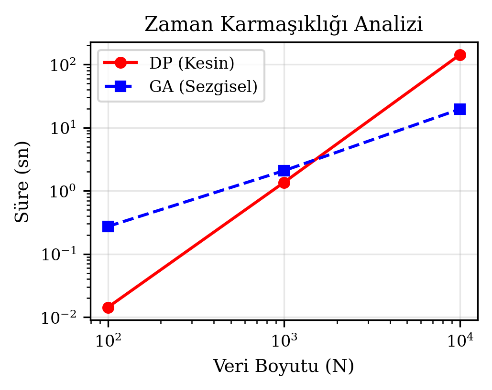
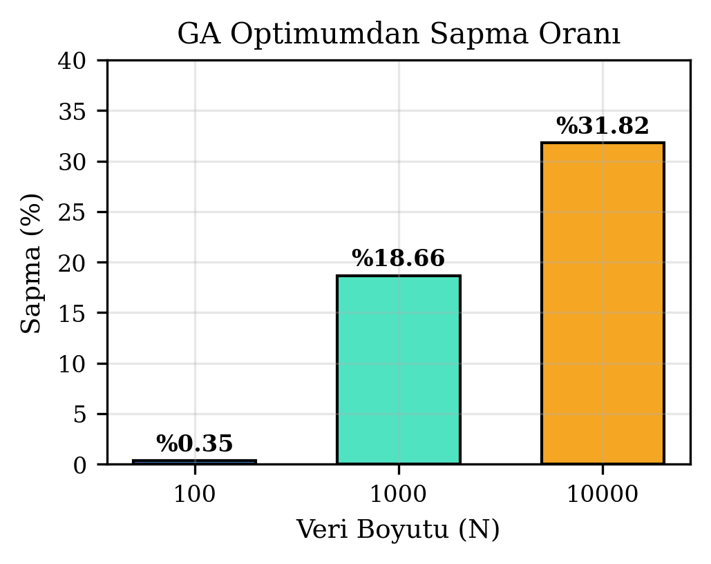

# Edge LLM ve RAG Sistemlerinde Önbellek (Cache) Optimizasyonu

Bu proje, 4 adet Mini PC (her biri 16 GB RAM) üzerinde kümelenmiş (clustered) olarak koşan Qwen 7B modeli ve KuzuDB tabanlı bir RAG (Retrieval-Augmented Generation) mimarisinin önbellek yönetimini optimize etmeyi amaçlamaktadır. 

Yönlendirici (Router) görevi gören ana PC1 üzerindeki kısıtlı 4 GB'lık boş RAM alanına (Cache Limit), dağıtık veritabanından gelen hangi bilgi parçalarının (chunk/token) yerleştirileceği problemi; **Dinamik Programlama (Kesin Çözüm)** ve **Genetik Algoritma (Sezgisel Çözüm)** yaklaşımlarıyla kıyaslanmıştır.

## 📌 Proje Özeti
Proje kapsamında, KuzuDB düğümlerinden dönen bilgi parçası aday sayısı N=100, N=1000 ve N=10000 olan farklı veri setleri (token grupları) üzerinde deneyler yapılmıştır. Temel odak noktası, bağlam (context) boyutu büyüdükçe RAG sisteminin kullanıcıya ilk kelimeyi verme süresi olan **TTFT (Time To First Token)** gecikmesi ile sistemin ürettiği cevapların **Uygunluk Skoru (Retrieval Rate)** arasındaki dengeyi (trade-off) analiz etmektir.

## 🚀 Kullanılan Algoritmalar

### 1. Dinamik Programlama (DP)
- **Yaklaşım:** Tablolama (Bottom-up) mantığı ile önbellek sınırını aşmadan elde edilebilecek maksimum uygunluk skorunu garanti eder.
- **Optimizasyon:** Bellek maliyetini (MemoryError) engellemek için 1-Boyutlu dizi optimizasyonu kullanılmıştır.
- **Dezavantaj:** Veri parçası (N) arttığında zaman karmaşıklığı çok yükselir, bu da Edge LLM senaryolarında kabul edilemez bir TTFT gecikmesine yol açar.

### 2. Genetik Algoritma (GA)
- **Yaklaşım:** Doğal seçilim, çaprazlama ve mutasyon mekanizmalarını kullanarak optimum cache tahsisini evrimsel olarak arar.
- **Parametreler:**
  - Popülasyon (Aday Cache Durumları): 100
  - Seçilim: Turnuva (k=3)
  - Mutasyon Oranı: %1
- **Avantaj:** Devasa arama uzaylarında, ideal uygunluk skorundan çok az saparak TTFT gecikmesini saniyeler seviyesine indirir.

## 📊 Deneysel Bulgular
Yapılan testlerde, N=10000 aday bilgi parçası seviyesinde Dinamik Programlama'nın yönlendirme süresi devasa bir hızla artarak **135 saniyeye** ulaşmış (çok yüksek TTFT gecikmesi), Genetik Algoritma ise aynı önbellek tahsis kararını yaklaşık **19 saniyede** vererek Edge cihazlar için daha uygulanabilir bir performans sergilemiştir.

### Zaman Karmaşıklığı Analizi (TTFT Gecikmesi)

### Doğruluk Sapma Oranı (İdeal Önbellekten Sapma)

## 👥 Proje Ekibi
* **Busenur Çam**
* **Metin Serinkaya**

## 📁 Proje Yapısı

    ├── src/
    │   ├── algorithms/
    │   │   ├── dp_solver.py         # DP tabanlı kesin önbellek çözümü
    │   │   └── ga_solver.py         # GA tabanlı sezgisel önbellek yönetimi
    │   ├── utils/
    │   │   ├── generator.py         # Token ve uygunluk skoru veri üreticisi
    │   │   └── plotter.py           # Akademik grafik çizdirme aracı
    │   └── main.py                  # RAG senaryosu ana yürütme dosyası
    ├── data/                        # JSON formatlı chunk veri setleri
    ├── results/                     # Çıktı grafikleri
    ├── report/
    │   └── Busenur_Metin_LLM_Cache_Report.docx  # Muş Alparslan Univ. Journal of Science Makalesi
    └── README.md                    # Proje dokümantasyonu